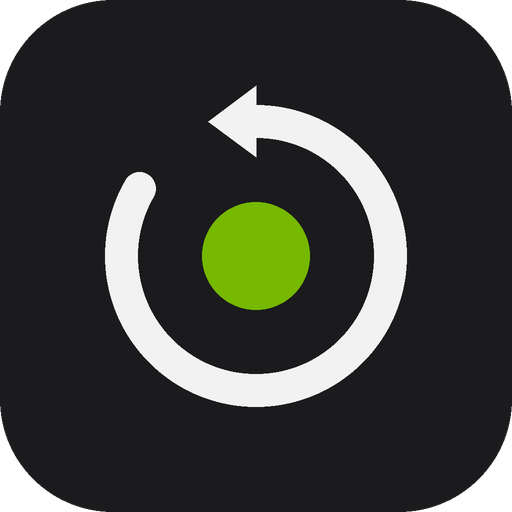
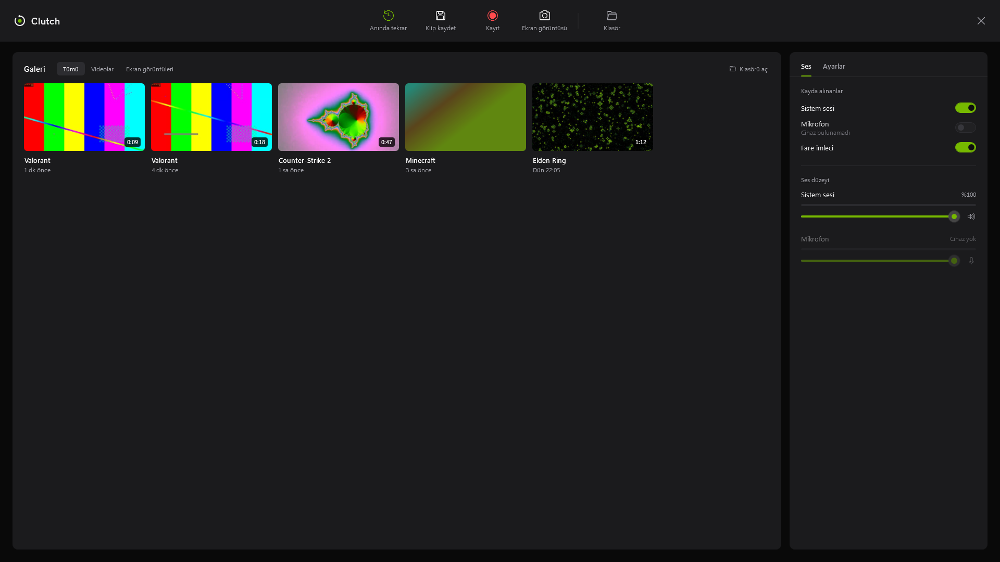
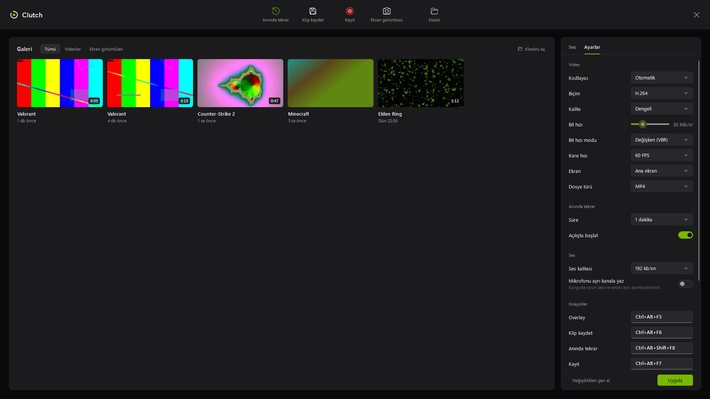
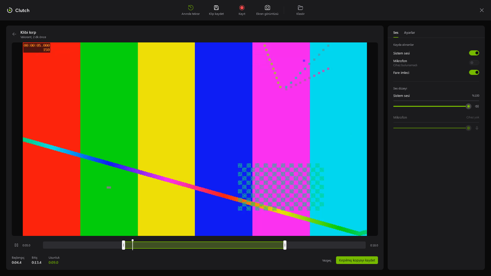

<p align="center">
  
</p>

<h1 align="center">Clutch</h1>

<p align="center">Kaçırdığın anı geri al. Windows için anında tekrar ve ekran kaydı.</p>

<p align="center">
  <a href="../../releases/latest">İndir</a>&nbsp;&nbsp;&nbsp;
  <a href="#kısayollar">Kısayollar</a>&nbsp;&nbsp;&nbsp;
  <a href="#kaynaktan-derleme">Kaynaktan derleme</a>
</p>

---

Clutch arka planda sessizce çalışır ve ekranının son 15 saniye ile 20 dakika arasını sürekli hafızada tutar.
Bir şey olduğunda tek tuşla o anı klip olarak kaydedersin. Ana penceresi yoktur; her şey oyunun üstünde açılan overlay'den yapılır.

Kodlama ekran kartında yapılır (NVIDIA NVENC, AMD AMF, Intel Quick Sync), oyun performansını neredeyse etkilemez.



## Özellikler

- **Anında tekrar:** son 15 sn – 20 dk her zaman hazır; kaydetmek anlık, yeniden kodlama yok.
- **Kayıt ve ekran görüntüsü:** uzun kayıtlar çökmeye karşı önce MKV'ye yazılır, durunca MP4'e çevrilir.
- **Galeri:** klipler oyun adına göre ayrılır; süre, tarih ve küçük resimle listelenir.
- **Kırpma:** klibin istediğin kısmını seç, kırpılmış kopyasını kaydet. Orijinal dosyaya dokunulmaz.
- **Ses:** sistem sesi ve mikrofon, ayrı ya da tek kanal. Ses düzeyi kayıt sürerken de ayarlanabilir.
- **Overlay kayda girmez:** overlay, bildirimler ve kayıt göstergesi videolarda ve ekran görüntülerinde görünmez.
- **Bildirimler:** kaydedilen klibin küçük resmiyle; tıklayınca klip açılır.
- Windows ile başlatma, sistem tepsisi, kendi kısayollarını atama, NVIDIA / Steam / Game Bar kısayol çakışması uyarısı.

## Ekran görüntüleri

| Ayarlar | Kırpma |
|---|---|
|  |  |

## Kurulum

[Releases](../../releases/latest) sayfasından `Clutch-v2.0.0-windows-x64.zip` dosyasını indir, bir klasöre çıkar ve `Clutch.exe`'yi çalıştır.
Kurulum ya da .NET gerekmez; ffmpeg pakete dahildir.

İmzasız olduğu için Windows SmartScreen uyarı verebilir: "Ek bilgi" ve ardından "Yine de çalıştır".

Windows Güvenliği'nde **Fidye yazılımı koruması (Denetimli klasör erişimi)** açıksa Clutch `Videolar` klasörüne yazamaz.
Bu durumda Clutch'a izin ver ya da Ayarlar > Genel'den başka bir kayıt yeri seç.

**Gereksinimler:** Windows 10 2004 veya üstü, 64 bit. Donanım kodlama için NVIDIA GTX 900+, AMD RX 400+ ya da Intel 6. nesil ve üstü (yoksa işlemciyle kodlar).

## Kısayollar

| Eylem | Varsayılan |
|---|---|
| Overlay | `Ctrl+Alt+F5` |
| Ekran görüntüsü | `Ctrl+Alt+F6` |
| Kayıt başlat / durdur | `Ctrl+Alt+F7` |
| Klip kaydet (anında tekrar) | `Ctrl+Alt+F8` |
| Anında tekrarı aç / kapat | `Ctrl+Alt+Shift+F8` |

NVIDIA (`Alt+Z`, `Alt+F9`, `Alt+F10`), Steam ve Xbox Game Bar kısayollarıyla çakışmayacak şekilde seçildi.
Overlay > Ayarlar > Kısayollar'dan kutuya tıklayıp yeni tuşa basarak değiştirebilirsin.

## Kullanım

- Overlay kısayolu ya da tepsideki simgeye tıklamak overlay'i açar. Esc ya da boş alana tıklamak kapatır.
- Galeride bir klibe tıkla: açılır. Sağ tık: kırp, klasörde göster, sil (Geri Dönüşüm Kutusu'na).
- Tepsideki simgenin ortasındaki nokta durumu gösterir: gri boşta, yeşil anında tekrar açık, kırmızı kayıtta.
- Klipler varsayılan olarak `Videolar\Clutch\<Oyun adı>\` altına kaydedilir.

## Kaynaktan derleme

.NET 10 SDK gerekir.

```
dotnet build src/Clutch
```

Çalıştırmak için `src/Clutch/ffmpeg/ffmpeg.exe` konumuna `ddagrab` içeren bir ffmpeg Windows derlemesi koy
(örneğin [gyan.dev](https://www.gyan.dev/ffmpeg/builds/) "essentials"). Yoksa Clutch PATH'teki ffmpeg'i kullanır.

Dağıtım paketini oluşturmak için:

```
./build.ps1
```

Çıktı `artifacts/Clutch-v<sürüm>-windows-x64.zip` olur (tek dosya exe + ffmpeg + lisans bildirimleri).

## Nasıl çalışır

Ekran Windows Desktop Duplication ile yakalanır, kareler ekran kartının belleğinden çıkmadan donanım kodlayıcıya gider.
Anında tekrar için ffmpeg sürekli 2 saniyelik parçalar yazar ve eskilerini siler; kaydet deyince son parçalar
yeniden kodlanmadan birleştirilir. Sistem sesi ve mikrofon WASAPI ile yakalanıp isimli borular üzerinden ffmpeg'e verilir.

Ayrıntılı tasarım notları: [docs/TASLAK.md](docs/TASLAK.md)

## Proje yapısı

```
src/Clutch/
  App.xaml(.cs)          açılış, tepsi, kısayollar
  Core/Capture/          ffmpeg, kodlayıcı seçimi, kayıt, anında tekrar, kırpma, küçük resim
  Core/Audio/            WASAPI yakalama, mikser, seviye göstergesi
  Core/Native/           Win32: kısayol, tepsi, kayda girmeme, başlangıç kaydı, geri dönüşüm kutusu
  Core/Settings/         ayarlar, kısayol ayrıştırma, bilinen çakışmalar
  Services/              uygulama durumu, galeri, tepsi
  ViewModels/  Views/    overlay, ayarlar, kırpma, bildirim
  UI/                    tema, kontroller (seviye göstergesi, kırpma şeridi, kısayol kutusu)
tools/make_icon.py       uygulama simgesini üretir
build.ps1                dağıtım paketi
```

## Lisans

[MIT](LICENSE). Pakete dahil edilen ffmpeg GPLv3 lisanslıdır; ayrıntılar [THIRD-PARTY-NOTICES.md](THIRD-PARTY-NOTICES.md) dosyasında.

---

<p align="center"><sub>TripleSS Development</sub></p>
